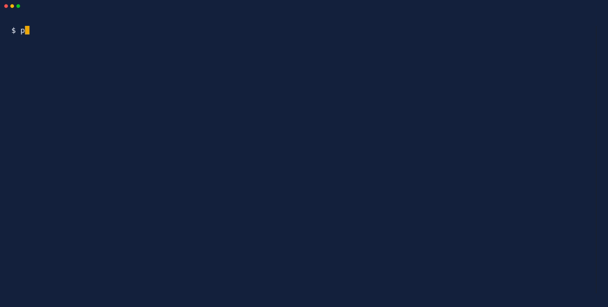
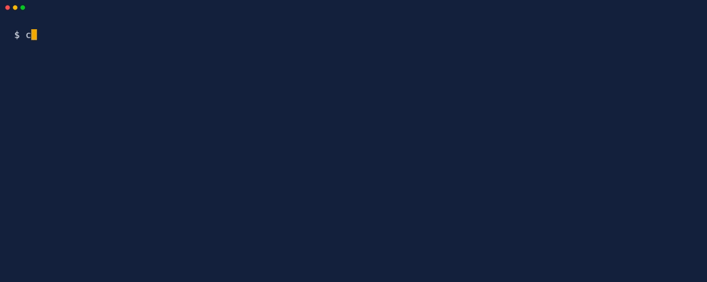
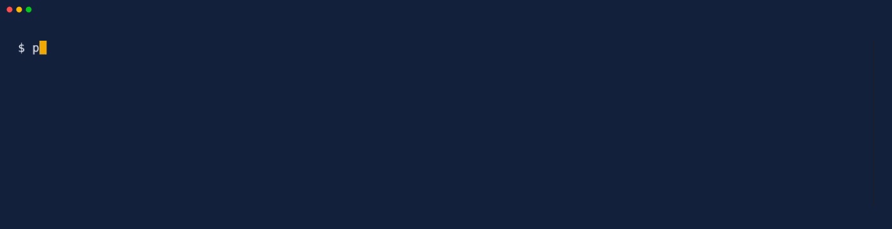

# Hotdog Not Hotdog

Drop a photo and find out whether it is a hot dog. A Laravel 13 playground for Jev's image input, using a Noul question for the verdict and a Box question to draw a box around the hot dog.

<!-- Browser recording of the app goes here: art/app.gif -->



The idea comes from the "Not Hotdog" app in HBO's *Silicon Valley*. This repo has no connection to the show.

## What this demonstrates

Jev ([TypeSafe](https://typesafe.ai)) is a model that answers typed questions instead of writing text. Version 1.14 can look at images, which makes a hot dog detector the smallest useful thing you can build with it. Along the way the repo shows:

- **Two question types in one request.** A Noul (yes/no) question decides HOTDOG, NOT HOTDOG or NOT SURE. A Box question finds where the hot dog is. Both go in a single request, because the image is billed as input tokens every time it is sent and output tokens are free.
- **Why Box is not enough on its own.** A Box question *always* returns a box, even for a photo of a dog. The Noul answer decides the verdict and the box is only drawn for HOTDOG.
- **A "not sure" band.** Confidence between 0.40 and 0.60 (configurable) shows NOT SURE instead of guessing. Both edges are inside the band.
- **Preparing images for a strict API.** Jev only accepts still PNG or JPEG between 280 and 1568 pixels per side, rejects anything else rather than resizing it, and ignores EXIF rotation. The app converts and resizes every upload first: phone HEICs, WebP, animated GIFs, 5000px photos and 100px thumbnails all work.
- **A preview API, handled honestly.** Image input needs the `TypeSafe-Danger-Zone-Images: true` header and the `jev-preview` (1.14) model. TypeSafe calls it "dreamer-ready", not production-ready.
- **Evals.** `samples/expected.json` is a small golden set and `php artisan hotdog:eval` scores the model against it. With Jev 1.14 the current score is **12 / 13 (92.3%)**: every easy photo is right, and the one miss is a sausage roll cut open so it looks like a sausage in bread (66%, just over the line).
- **A fake mode.** The app works straight after cloning, with no key, using a stand-in detector. CI runs entirely on it.

Image support in Jev is a preview: request formats, answers and limits may change between releases.

## Tech stack

| Area | Choice |
|------|--------|
| Framework | Laravel 13, PHP 8.3+ |
| UI | Livewire 3 (file uploads), Tailwind 4, Vite 8, self-hosted fonts |
| Images | Intervention Image 3 with GD, or Imagick when installed (needed for HEIC) |
| Jev | A thin client on Laravel's HTTP client (see [Architecture notes](#architecture-notes)) |
| Storage | None. No database; sessions and cache use files |
| Quality | Pest 4, Larastan level 8, Pint with strict types, 100% line coverage on `app/` |
| Tooling | Husky git hooks, osv-scanner, GitHub Actions, VHS terminal recordings |

## Getting started



### Prerequisites

- PHP 8.3 or newer with the `gd` and `exif` extensions. `imagick` is optional; HEIC photos need it, built with HEIC support
- Composer 2.8 or newer (the scripts use a token older versions do not understand: `composer self-update`)
- Node.js and npm
- [osv-scanner](https://github.com/google/osv-scanner) for the pre-commit security audit: `go install github.com/google/osv-scanner/cmd/osv-scanner@latest`
- `pcov` if you want coverage reports: `sudo apt install php8.4-pcov`
- A Jev API key from [typesafe.ai](https://typesafe.ai) if you want real answers. You do not need one to try the app

Running `npm install` once activates the git hooks.

If you use Claude Code, `.mcp.json` configures Playwright, GitHub, Context7 and MySQL MCP servers:

- GitHub MCP authenticates with `gh auth token`, so run `gh auth login` once per machine
- MySQL MCP reads `MYSQL_HOST`, `MYSQL_PORT`, `MYSQL_USER`, `MYSQL_PASSWORD` and `MYSQL_DATABASE` from your shell (default `127.0.0.1:3306`, user `root`). This app has no database, so you only need it for other projects
- Playwright and Context7 need nothing beyond `npx`

### Run it

1. `git clone https://github.com/phoenix1331/laravel-jev-hotdog && cd laravel-jev-hotdog`
2. `composer install && npm install && npm run build`
3. `cp .env.example .env && php artisan key:generate`
4. `php artisan hotdog:check` to see which mode you are in and, with a key, to test it
5. `composer serve` and open the URL it prints (http://127.0.0.1:8000, or the next free port)

The app starts in **fake mode**: answers are made up locally and no photo leaves your machine. Use `composer serve` or `composer dev` rather than plain `php artisan serve`: they load `php.d/uploads.ini`, which raises PHP's upload limit from the usual 2 MB to 20 MB so phone photos work. If you use Herd, raise `upload_max_filesize` and `post_max_size` in Herd's PHP settings instead.

### Using your own Jev key

Add your key and turn fake mode off in `.env`:

```env
JEV_API_KEY=your-key
JEV_FAKE=false
```

Then check the setup with one tiny request (a blank 280px image):

```bash
php artisan hotdog:check
```



Keep `JEV_MODEL` on `jev-preview` or `jev-1.14.0`. `jev-latest` still points to Jev 1.13, which is text only.

### Fake mode

With `JEV_FAKE=true` the app uses `FakeHotdogDetector`. It never looks at the picture:

- For a bundled sample, it reads the expected answer from `samples/expected.json` (tricky samples land nearer the "not sure" band, but stay right)
- For anything else, it turns a hash of the image into a confidence, a box and a latency, so the same photo always gets the same answer

That makes every screen of the app reachable without a key, and lets CI run without secrets. It also means the fake's verdicts, and its boxes, mean nothing.

### Commands

| Command | What it does |
|---------|--------------|
| `composer serve` | `php artisan serve` with the upload limits in `php.d/` |
| `composer dev` | Server, Vite, queue and logs together, with the same limits |
| `composer test` | Run the test suite |
| `composer coverage` | Tests with coverage, failing below 90% |
| `composer lint` / `composer lint:check` | Fix or check code style with Pint |
| `composer analyse` | Larastan static analysis |
| `composer record` | Re-record the terminal GIFs in `art/` (needs [VHS](https://github.com/charmbracelet/vhs), ttyd 1.7.2+ and ffmpeg) |
| `php artisan hotdog:check` | Show the settings and test the key, model and image header |
| `php artisan hotdog:eval` | Score the current detector against the sample photos |

## Evaluating Jev

```bash
php artisan hotdog:eval                 # every sample
php artisan hotdog:eval --only=tricky   # just the hard ones
php artisan hotdog:eval --min=90        # exit with an error below 90%
```

Each available sample goes through the same normaliser and detector as the app, then the command prints a table of results with overall, easy and tricky accuracy. NOT SURE counts as a miss and is also counted separately. In Jev mode it says how many images it is about to send and asks first; `--force` skips the question.

In fake mode the score is always 100%, because the fake reads the answers. CI still runs it (`--min=100`) because it proves every committed photo loads, converts and goes through the whole pipeline.

### Samples

| Group | Photos |
|-------|--------|
| Easy yes | classic, chilli dog, hot dog with fries |
| Tricky yes | a foot-long seen side-on, a tray of several |
| Tricky no | bratwurst with no bun, sausage roll, corn dog, dachshund |
| Edge cases | 5000px JPEG, 100px PNG, WebP, animated GIF |

The photos are CC0 or public domain images from Wikimedia Commons; the edge cases are drawn by `samples/generate-edge-cases.php`. Every file's author, licence and source is in [`samples/CREDITS.md`](samples/CREDITS.md), along with a short list of photos still wanted (a half-eaten hot dog, a dog in a hot dog costume, a banana in a bun). Add your own and list them in `expected.json`; the app and the eval pick them up.

## Privacy

- In fake mode nothing leaves your machine
- With `JEV_FAKE=false`, every photo you check is sent to TypeSafe's API. See TypeSafe's [privacy and data handling](https://docs.typesafe.ai/legal)
- Nothing is stored. Uploads sit in Livewire's temporary folder only while they are checked, then are deleted; the converted image is held in memory
- The log records only the verdict, confidence, latency, model and TypeSafe's request id, never the image
- Your key stays in `.env`, which git ignores. Tests, CI and the recordings in `art/` all run in fake mode with an empty key

## Environment variables

| Key | Default | Description |
|-----|---------|-------------|
| `JEV_API_KEY` | (empty) | Your TypeSafe API key. Never commit it |
| `JEV_FAKE` | `true` | `true` answers locally; `false` asks Jev |
| `JEV_MODEL` | `jev-preview` | Must support images and Box: `jev-preview` or `jev-1.14.0` |
| `JEV_BASE_URL` | `https://api.typesafe.ai/v1` | API base URL |
| `JEV_TIMEOUT` | `30` | Request timeout in seconds |
| `HOTDOG_UNSURE_MIN` | `0.40` | Lower edge of the NOT SURE band |
| `HOTDOG_UNSURE_MAX` | `0.60` | Upper edge of the NOT SURE band; above it is HOTDOG |
| `HOTDOG_MAX_UPLOAD_KB` | `20480` | Largest upload accepted, in KB |
| `HOTDOG_RATE_LIMIT` | `20` | Checks per minute per IP address |
| `HOTDOG_IMAGE_DRIVER` | `auto` | `auto` (Imagick when installed, else GD), `gd` or `imagick` |
| `HOTDOG_MAX_INPUT_MEGAPIXELS` | `50` | Larger images are refused before decoding, to protect memory |

## Endpoints

The app is one Livewire page, so there is no JSON API. [`request.http`](request.http) has the plain HTTP routes for VS Code REST Client or JetBrains HTTP Client:

| Route | Purpose |
|-------|---------|
| `GET /` | The app |
| `GET /samples/{file}/thumbnail` | A cached 480px JPEG of a bundled sample; 404 for anything not in `expected.json` |
| `GET /up` | Laravel's health check |

## Architecture notes

**A thin client instead of an SDK.** Nine PHP clients for Jev were on Packagist when this was built. Only one supported images and Box, and it sends requests through its own Guzzle client, so Laravel's `Http::fake()` cannot intercept them. The app needs one endpoint and two question types, so `app/Jev/JevClient.php` is about 120 lines on Laravel's HTTP client. It sends the preview header on every call, retries only rate-limited (429) and overloaded (529) responses, and maps every failure to a message safe to show on screen.

**One interface, two detectors.** `HotdogDetector` has a single method, `detect(NormalisedImage): HotdogResult`. `JevHotdogDetector` and `FakeHotdogDetector` both implement it, and `JEV_FAKE` picks one in `HotdogServiceProvider`. The Livewire component, the eval command and the tests never know which is in use.

**The box is a fraction, so the overlay is plain CSS.** Box edges come back as fractions of the image (0 to 1), so `top: 20%; left: 19%` places the box at any display size. The page shows the converted image Jev saw rather than your original, so the box still lines up when an unusual shape had to be padded.

**Normalise everything, trust nothing.** `ImageNormaliser` checks the real file type from the bytes, refuses huge images before decoding them, rotates using EXIF, strips metadata, keeps the first frame of an animation, flattens transparency onto white, and fits each side into 280 to 1568 pixels. A very long, thin image cannot meet both limits by scaling alone, so it is scaled down and padded.

**One percentage on screen.** Box answers carry their own confidence, but it measures how sure Jev is of the box edges, not whether the photo is a hot dog. Shown next to the main confidence it read as a contradiction, so the page shows only the Noul confidence.

**Upload limits live in three places.** PHP (`php.d/uploads.ini`), Livewire's temporary upload rule (`config/livewire.php`) and the component's own validation. The page advertises the smallest of them, and the friendly error messages live in `lang/en/validation.php` because Livewire validates uploads before the component sees them.

More detail on decisions and the layout of the code is in [`CONTEXT.md`](CONTEXT.md).

## Contributing

Developed on Ubuntu under WSL. Before opening a pull request:

```bash
composer lint
composer analyse
composer coverage
```

Commit messages are lowercase [Conventional Commits](https://www.conventionalcommits.org/) with no scope, for example `feat: add welsh cake detector`. The `commit-msg` hook rejects anything else, and the `pre-commit` hook runs Pint and osv-scanner.

## Licence

The code is MIT licensed: see [`LICENSE.md`](LICENSE.md). The sample images keep their own licences, listed in [`samples/CREDITS.md`](samples/CREDITS.md).
